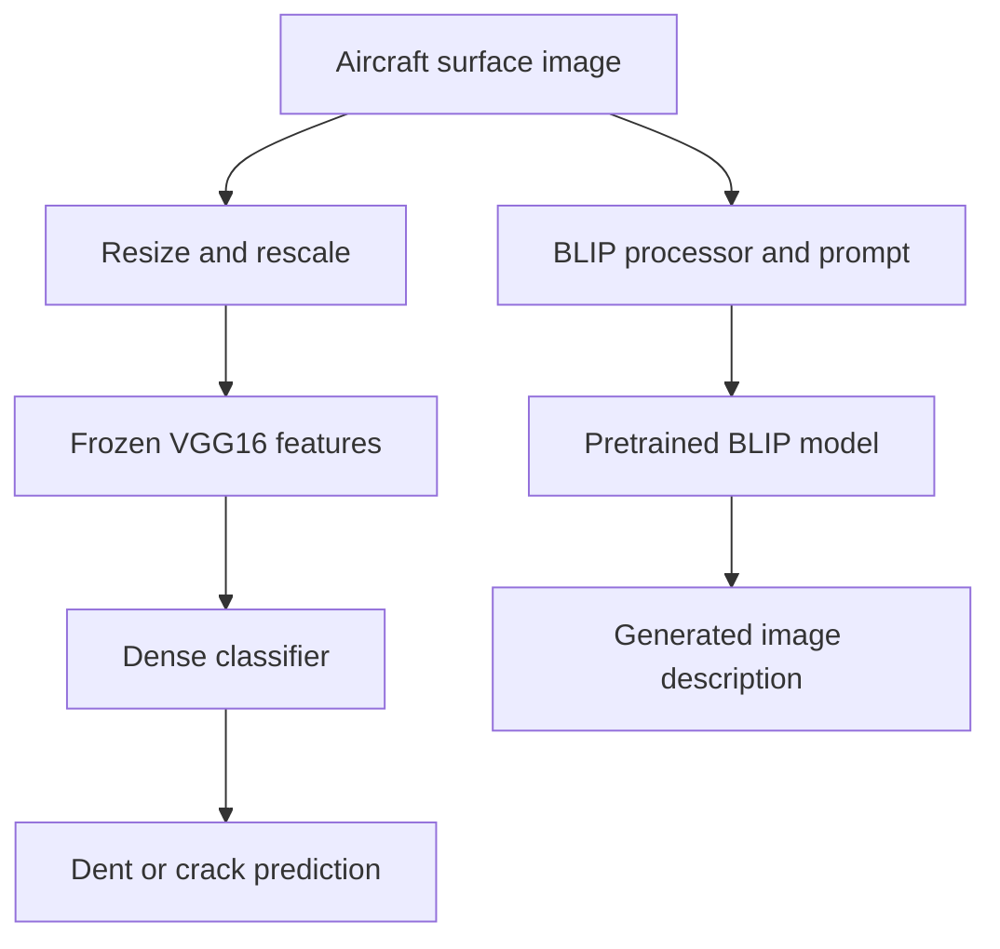

# ✈️ Aircraft Surface Damage Classification & Captioning

Explore **dent-versus-crack classification with VGG16** and **image description with BLIP** in a notebook-based computer vision project.


[Overview](#-project-overview) · [Example](#-example-output) · [Architecture](#-architecture) · [Quick start](#-quick-start) · [Author](#-author) · [Contact](#contact)

---

## 🎯 Project overview

Visual inspection involves both recognizing damage and communicating what an image shows. This project explores those tasks through two complementary models: a binary surface-damage classifier and a pretrained image-captioning model.

The work is an **educational notebook prototype**. It connects transfer learning with vision-language generation, an approach I am interested in exploring further for equipment inspection and maritime maintenance.

## 🏆 Project highlights

- **Transfer learning:** frozen ImageNet VGG16 features with a custom binary classifier.
- **Image preparation:** 224 × 224 resizing and pixel rescaling through directory-based generators.
- **Training workflow:** separate training, validation, and test directories, accuracy/loss curves, and test evaluation.
- **Vision-language generation:** Salesforce BLIP produces prompted image descriptions.
- **Framework integration:** a custom Keras layer invokes PyTorch text generation through `tf.py_function`.

## 🖼️ Example output


The notebook explores classification and generated descriptions separately. A generated description should be checked against the image; it is not an inspection finding.

## 🏗️ Architecture



### Training configuration

| Setting | Notebook implementation |
| --- | --- |
| Image size | 224 × 224 RGB |
| Feature extractor | VGG16, ImageNet weights, frozen layers |
| Classifier | Two Dense 512 layers, each followed by Dropout 0.3; sigmoid output |
| Optimizer | Adam, learning rate 0.0001 |
| Loss | Binary cross-entropy |
| Batch size / epochs | 32 / 5 |
| Caption model | `Salesforce/blip-image-captioning-base` |

The notebook's “caption” and “summary” modes use different prompts with the same BLIP model. The summary mode generates an image description rather than summarizing a maintenance report.

## 🚀 Quick start

```bash
git clone https://github.com/IBOSS24/Aircraft-Surface-Damage-Classification-and-Captioning.git
cd Aircraft-Surface-Damage-Classification-and-Captioning
python -m venv .venv
```

Activate with `source .venv/bin/activate` on Linux/macOS or `.\.venv\Scripts\Activate.ps1` in Windows PowerShell:

```bash
python -m pip install -r requirements.txt
python -m pip install jupyter
python -m jupyter notebook
```

Open the aircraft classification notebook from the file browser. Review the data-download cell before running it: it downloads an archive and removes an existing `aircraft_damage_dataset_v1` directory before extraction.

The dataset and pretrained weights require network access. The requirements specify TensorFlow 2.17.1 and Transformers 4.38.2, with some other dependencies unpinned; a clean installation has not been verified in this documentation update.

## 📂 Repository guide

| Path | Contents |
| --- | --- |
| [Classification and captioning notebook](Aircraft-surface-damage-classification%20%20.ipynb) | Data download, VGG16 training, evaluation, and BLIP experiments |
| [requirements.txt](requirements.txt) | Python dependencies |
| [image/](image/) | Example prediction screenshot |

## 📊 Evaluation and scope

The notebook includes training curves and test evaluation code. A reproducible results report should accompany any published performance figures.

Current points to address in further development:

- Evaluate the complete test set; the current evaluation uses a floor-divided batch count.
- Add per-class precision/recall, a confusion matrix, and independent checks of generated descriptions.
- Separate classifier and caption-model variable names for clearer notebook execution.
- Validate behavior on unfamiliar surfaces, lighting conditions, and damage types.

## 🔭 Next steps

- Package inference into reusable modules with automated checks.
- Explore damage localization and additional damage categories.
- Evaluate domain adaptation for maritime equipment imagery.
- Investigate deployment after establishing reproducible evaluation.

## 🙏 Acknowledgments

The notebook uses an IBM Skills Network course-hosted aircraft dataset, ImageNet-pretrained VGG16, and Salesforce's BLIP image-captioning model. Check the original data and model terms before redistribution.

---

## 👨‍💻 Author

**Mohammed Badr**  
State-qualified engineer · Moroccan Royal Navy officer · Building a career in maritime Data Science & ML Engineering

I bring experience at sea and in maritime command centers to my work in applied machine learning. My focus is developing reliable ML systems and applying them to maritime traffic forecasting, vessel behavior analysis, and equipment reliability.

[](https://github.com/IBOSS24/Portfolio_)
[](https://www.linkedin.com/in/mohammed-e-a13664182)
[](#contact)

<a id="contact"></a>

## 📬 Contact

<details>
<summary>Show email and contact details</summary>

- **Email:** med.marin17@gmail.com
- **Gmail:** [Compose an email in Gmail](https://mail.google.com/mail/?view=cm&fs=1&to=med.marin17%40gmail.com)
- **Mail app:** [med.marin17@gmail.com](mailto:med.marin17@gmail.com)
- **LinkedIn:** [Mohammed E.](https://www.linkedin.com/in/mohammed-e-a13664182)
- **GitHub:** [IBOSS24](https://github.com/IBOSS24)
- **Portfolio:** [View my projects](https://github.com/IBOSS24/Portfolio_)

</details>
